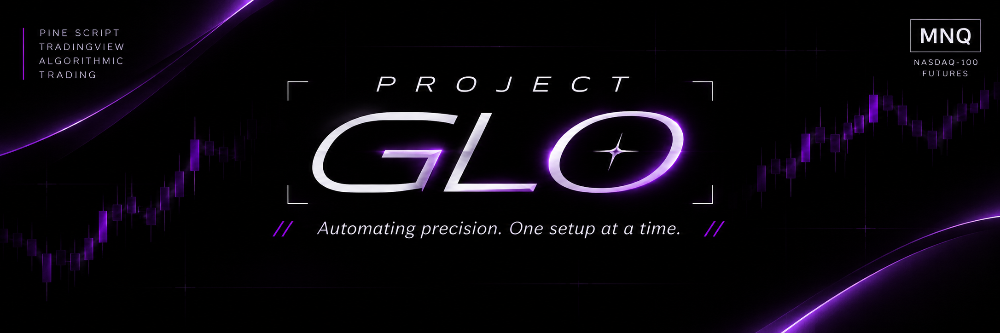

  

# PROJECT GLO

### Algorithmic Trading • MNQ Futures • Pine Script v6

---

## About

**Project Glo** is an experimental algorithmic trading system designed for Micro E-mini Nasdaq-100 (MNQ) futures.

Inspired by Powell's 10 AM New York trading strategy, Glo aims to automate price-action analysis, opening-price retests, market structure detection, and risk management.

The project is currently in active development and backtesting.

## Core Features

- 10:00 AM New York opening-price detection
- Multi-timeframe signal analysis (1m, 3m, 5m)
- Price-action retest confirmation
- Structural stop-loss and take-profit calculations
- Minimum 1:3.5 risk-to-reward filter
- One trade per New York trading day
- TradingView strategy visualization

## Development Status

**Current version:** v0.3 — Experimental

Glo is not yet validated for live trading.

| Component | Status |
|---|---|
| 10 AM opening-price detection | Testing |
| Multi-timeframe signals | Testing |
| Retest confirmation | Testing |
| Structural risk management | Experimental |
| Historical backtesting | In progress |
| Live trading integration | Not implemented |

## Roadmap

- [x] Initial Pine Script strategy
- [x] Opening-price visualization
- [x] Initial multi-timeframe detection
- [ ] Validate retest signals
- [ ] Improve structural liquidity targeting
- [ ] Evaluate historical performance
- [ ] Add realistic trading costs and slippage
- [ ] Validate forward-testing results
- [ ] Explore supported broker integration

## Technology

- **Language:** Pine Script v6
- **Platform:** TradingView
- **Market:** MNQ Futures
- **Development:** Independent experimental project

## Credits

The underlying trading approach is inspired by Powell's publicly shared trading strategy.

Project Glo is independently developed and is not affiliated with or endorsed by Powell.

## Disclaimer

This project is intended for research, education, and strategy testing. It is not financial advice, and no profitability is guaranteed.

---

**PROJECT GLO — BUILD. TEST. REFINE.**

